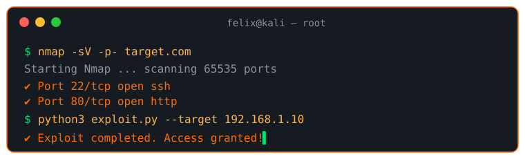
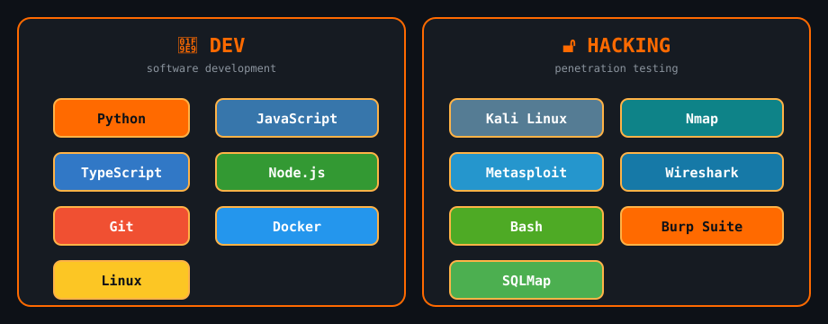

<div align="center">

<!-- Animierter Matrix-Regen (externes SVG, SMIL-Animation) -->


<br/>

<!-- Animiertes Terminal (externes SVG, SMIL-Animation) -->


<br/>

<!-- Animierter Code-Editor (externes SVG, SMIL-Animation) -->


</div>

<br/>

<!-- ============================================================
     STACK + SKILLS – animierte Panels & Skill-Bars (SMIL-SVG)
============================================================ -->
<div align="center">

<!-- Animierte Stack-Panels (Dev & Hacking) mit pulsierenden Tech-Tags -->


<br/>

<!-- Animierte Skill-Bars (Fortschrittsbalken füllen sich) -->


</div>

---

<!-- ============================================================
     KONTAKT
============================================================ -->
<div align="center">

## 📡 Kontakt

[](https://github.com/felix-fab)
[](mailto:felix@example.com)
[](https://www.linkedin.com/in/felix)
[](https://x.com/felix)
[](https://discord.com/users/felix)

</div>

---

<div align="center">

```
  ██████╗ ██████╗ ██████╗ ███████╗   ██╗  ██╗ █████╗  ██████╗██╗  ██╗
 ██╔════╝██╔═══██╗██╔══██╗██╔════╝   ██║  ██║██╔══██╗██╔════╝██║ ██╔╝
 ██║     ██║   ██║██║  ██║█████╗     ███████║███████║██║     █████╔╝ 
 ██║     ██║   ██║██║  ██║██╔══╝     ██╔══██║██╔══██║██║     ██╔═██╗ 
 ╚██████╗╚██████╔╝██████╔╝███████╗   ██║  ██║██║  ██║╚██████╗██║  ██╗
  ╚═════╝ ╚═════╝ ╚═════╝ ╚══════╝   ╚═╝  ╚═╝╚═╝  ╚═╝ ╚═════╝╚═╝  ╚═╝
```

</div>
